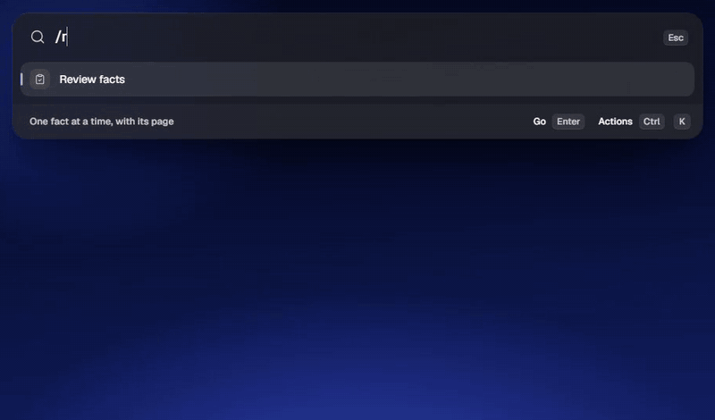

# Sniff

Sniff is a desktop app that indexes the documents on your laptop (PDFs, Office files, scans and photos), works out what each one is, extracts key details such as dates, amounts and expiry dates, and answers questions about them with links to the source page. You can check and correct the extracted details on a review screen. It can add expiry and due dates to Google Calendar, and AI tools such as Claude Code can query it through MCP.

Reading, OCR, the models, the index and the answers all run on the laptop. Two optional features send data out; see [What leaves the laptop](#what-leaves-the-laptop).


Find a file and look at its page before opening it:


Ask a question. Two copies of a fee voucher disagree, so Sniff shows both totals and you pick the right copy:


Check one extracted value at a time, next to the part of the page it came from:



Recorded from the launcher running in a browser against the real back end, on the synthetic test documents (all names are made up), with the chat model off.

Sniff started as a term project for the Generative AI course (AI-4009) at FAST-NUCES. How it is evaluated is in [docs/EVAL.md](docs/EVAL.md).

## How it works

| Step | What happens | AI or code |
|---|---|---|
| Read | PDF, DOCX, PPTX and text are read page by page; scanned pages and photos go through OCR (RapidOCR) | AI (OCR) |
| Index | Text is split into passages, embedded (all-MiniLM-L6-v2) and stored with a BM25 keyword index in SQLite | AI (embeddings) |
| Type | A small local LLM (Qwen3-1.7B) picks the document type | AI |
| Facts | The LLM extracts the type's fields as JSON that must match a schema. Code then checks each value: it must be on the page, next to its field's label, and pass the field's rules ([docs/FIELDS.md](docs/FIELDS.md)). Otherwise it is marked "needs review" with a reason | AI + code |
| Review | The review screen lists facts that need review; you can correct or approve them | Code |
| Ask | The LLM routes the question: either it fills a fixed facts query, which code runs (sums, counts, dates), or hybrid search finds passages and the LLM answers from them with citations. Exact copies are counted once and conflicting values are shown side by side ([docs/CALCULATIONS.md](docs/CALCULATIONS.md)) | AI + code |
| Remind | Expiry and due dates become Google Calendar events after you click to approve | Code |
| Stay fresh | Each file's size, time and hash are stored; re-scans re-index only changed files, renames keep their data, deleted files are removed, and cited files are re-checked before an answer is shown | Code |

## What leaves the laptop

| Feature | Off by default? | What is sent, and to whom |
|---|---|---|
| Google Calendar reminders | Yes. Nothing is sent until you click "Add to Google Calendar" on a date | To Google: the event title (document type, which date it is, and the holder's name or the provider/shop), the date, and the file name and page. Not the folder path, not the document text |
| MCP (Claude Code and other agents) | Yes. Only runs if you add the MCP server to an agent | To the agent and whatever model it uses (for Claude Code, Anthropic's servers): the snippets, facts, answers and full file paths it asks for. ID cards and unclassified files are hidden, ID numbers are masked, and every call is logged to `.sniff/mcp_access.log`. The allow-list is `MCP_ALLOW` in `backend/sniff/config.py` |

## Run it (Windows)

Requirements: Python 3.11 with [uv](https://docs.astral.sh/uv/), Node 22, and about 50 MB of disk for the embedding model (1.4 GB more for the optional chat model). The app was built and tested on Windows 11.

```powershell
# 1. llama.cpp (CPU build b12628): unzip it into models/llama/
#    https://github.com/ggml-org/llama.cpp/releases/download/b12628/llama-b12628-bin-win-cpu-x64.zip

# 2. back end and the embedding model (all-MiniLM-L6-v2, 46 MB; sha256 checked). Add qwen3-1.7b
#    (Qwen3-1.7B Q4_K_M, 1.4 GB) only to run AI on this laptop (Settings > AI > This laptop)
cd backend
uv sync
uv run python ../eval/fetch_models.py all-minilm

# 3. front end
cd ../frontend
npm install

# 4. start everything from the repo root: embeddings on 8081, API on 8000, UI on 5173
#    (the API starts the chat model on 8080 when it needs it, and stops it after 120 s idle)
cd ..
powershell -ExecutionPolicy Bypass -File scripts\dev.ps1
```

Open http://localhost:5173, type `/watch`, press Enter, then type a folder path and press Enter. Sniff indexes it and keeps it up to date. Type `/` to see the other commands. The index is `.sniff/sniff.db`; set `SNIFF_DB` to use another file. `VITE_MOCK=1 npm run dev` runs the UI on fixture data, without the back end.

To start the parts by hand (for example on another OS), these are the commands `dev.ps1` runs. If a chat server
already answers on 8080 (the first line), the API uses it and never stops it:

```bash
models/llama/llama-server -m models/qwen3-1.7b-q4_k_m.gguf --port 8080 --jinja --reasoning-budget 0 -c 8192   # optional
models/llama/llama-server -m models/all-minilm-l6-v2.gguf --embedding --port 8081 -c 2048 -b 2048 -ub 2048
cd backend && uv run uvicorn sniff.api:app --port 8000
cd frontend && npm run dev
```

**Google Calendar (optional):** create an OAuth client (Desktop app) in a Google Cloud project with the Calendar API enabled, and save its JSON as `backend/.secrets/google_client.json`. The first reminder opens a Google sign-in page.

**Reminders without Google:** `GET /reminders/ics?file_id=<id>&field=expiry_date` returns an all-day `.ics` event with alerts 7 days and 1 day before. Open it in any calendar app. Only the file name goes in the description.

**Indexing in two steps:** a new file is read, cut into chunks and embedded first, which takes about a second (more for a scan that needs OCR); search finds it from then on. Its type and facts are read later by one background worker, oldest file first, from a queue kept in the database, so a restart picks up where it stopped. The worker waits while someone is searching or asking. `GET /index/status` gives `queued`, the number of files still waiting, and the launcher shows "reading facts: N left". Search results whose facts are not read yet carry `"reading": true`. `POST /ask/stream` returns the same answer as `POST /ask` as server-sent events: `token` events while a search answer is written, then one `answer` event.

**Keep a folder live:** `POST /watch {"folder": "..."}` makes the back end watch it. New, edited, renamed and deleted files are picked up about 2 seconds after the folder goes quiet. Office lock files (`~$`) and partial downloads (`.crdownload`, `.part`, `.tmp`) are ignored. `GET /watch` lists the folders and `DELETE /watch {"folder": "..."}` stops one. The list is stored in the database and watched again after a restart.

**Docker (not built or run on our machines):** `Dockerfile` builds the back end and `docker-compose.yml` adds two llama.cpp server containers, one for chat and one for embeddings. Put the model files in `models/` first. We only ran `docker compose config` to check the file, because Docker's disk is on a drive that is nearly full. Building the image and running the stack is untested. Changes inside a Windows folder mounted into a container may not reach the watcher, so use `POST /index` there.

```bash
docker compose up --build        # API on http://127.0.0.1:8000; SNIFF_DOCS=/path/to/docs sets the mounted folder
```

**CI:** `.github/workflows/ci.yml` runs the back end tests (fake models only) and the front end build on every push. It has not run yet, because nothing is pushed.

**Use Sniff from Claude Code (optional):**

```bash
claude mcp add sniff -- uv --directory /path/to/sniff/backend run python -m sniff.mcp_server
```

MCP is **off until you turn it on**: `PUT /mcp/settings` with `{"enabled": true, "allow": {"utility_bill": ["*"]}}`. While it is off, every tool refuses and the call is still logged. `GET /mcp/settings` shows the current settings and `GET /mcp/log?limit=50` the recent calls. Changes apply on the next call, without a restart. Without a saved list, the default is `config.MCP_ALLOW`, which gives field lists only (no page text) and hides ID cards, passports, bank statements, offer letters, transcripts and unclassified (`other`) files until you grant them. Setting `SNIFF_MCP_ALLOW` (JSON) overrides the database and turns MCP on, for development.

## Tests and evaluation

```bash
cd backend
uv run pytest                     # functional tests
```

The evaluation (test sets, metrics, baselines, the run order and the results) is in [docs/EVAL.md](docs/EVAL.md). Results go to `eval/results/`; the app does not show them, but `GET /eval` returns them. Failure examples are saved next to them for error analysis. The OCR baseline needs Tesseract (`C:\Program Files\Tesseract-OCR`).

## Team

Ibraheem Farooq, Wajih ur Raza, Ali Aan. Supervisor: Dr. Akhtar Jamil.
