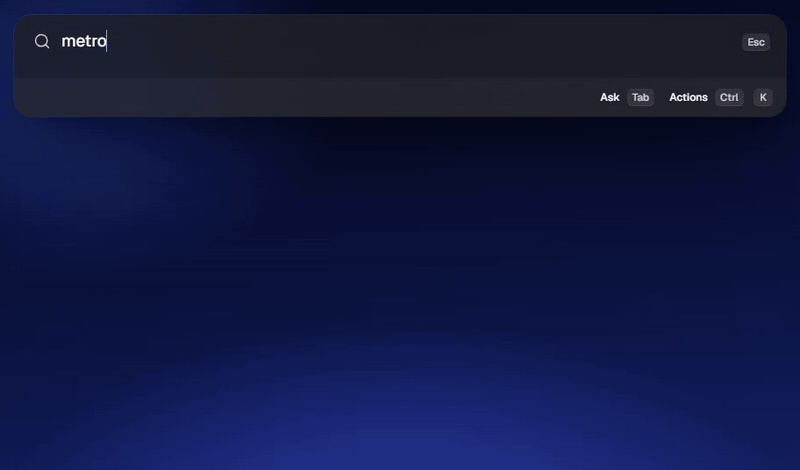

# Sniff

Sniff reads the documents already on your computer (bills, receipts, ID cards, certificates, letters, scans and phone photos), works out what each one is, pulls out the details that matter (dates, amounts, expiry dates, ID numbers) and answers questions about them, with a link to the page each answer came from.

It runs on your computer. It works with AI switched off, and that is how it starts.

**[Download Sniff](https://github.com/wajih-rathore/sniff/releases/latest)** for Windows, macOS or Linux. Free and open source (MIT).

## What you can do with it

**Find a file by what is in it**, even a scan or a photo, and see its page before you open it:

**Ask a question across your documents.** "How much did I pay for electricity this year?" is added up by code from the bills it found, never guessed by a model. When two copies disagree, Sniff shows both and lets you pick:

**Check what it read.** Each extracted value sits next to the part of the page it came from, so you can accept or correct it:

**Get reminded** a week before a passport, ID card, warranty or insurance policy expires, or before a bill is due.

**Let your AI assistant use it (optional).** Tools such as Claude Code can search your documents through MCP, limited to the document types you allow.

The recordings use made-up documents.

## Download and install

Get the file for your computer from the [latest release](https://github.com/wajih-rathore/sniff/releases/latest):

| Your computer | File |
|---|---|
| Windows 10 or 11 (64-bit) | `Sniff_<version>_x64-setup.exe` |
| Mac with Apple silicon (M1 and later), macOS 15 or later | `Sniff_<version>_aarch64.dmg` |
| Mac with Intel, macOS 15 or later | `Sniff_<version>_x64.dmg` |
| Debian or Ubuntu 22.04 and later | `Sniff_<version>_amd64.deb` |
| Other Linux (64-bit) | `Sniff_<version>_amd64.AppImage` |

The installers are not code-signed yet, so your system will warn you the first time:

- **Windows:** SmartScreen says it protected your PC. Click **More info**, then **Run anyway**. Sniff installs for your user only and needs no administrator rights.
- **macOS:** open Sniff once and close the warning, then go to **System Settings > Privacy & Security** and click **Open Anyway**. If macOS says Sniff is damaged, run `xattr -dr com.apple.quarantine /Applications/Sniff.app`.
- **Linux:** `sudo apt install ./Sniff_<version>_amd64.deb`, or make the AppImage executable (`chmod +x`) and run it.

The Windows build is the one we use every day. The macOS and Linux builds are new: they are built and started by our CI on every release, but few people have run them yet, so please [tell us](https://github.com/wajih-rathore/sniff/issues) if something breaks. The full guide for each system, including where files go and how to uninstall, is in [docs/INSTALL.md](docs/INSTALL.md).

## Getting started

1. Start Sniff. The first time, it downloads its search model (46 MB). Nothing else is needed.
2. Press **Alt+Shift+Space** (Option+Shift+Space on a Mac) to open Sniff from any app. You can change the shortcut in Settings.
3. Choose **Add a folder…** and pick a folder with your documents. Sniff reads it and keeps it up to date as files are added, changed, renamed or deleted.
4. Type to search. Press **Tab** to ask a question instead. **Review** lists the values Sniff is unsure of.

Sniff lives in the tray (the menu bar on a Mac). Closing the window only hides it; **Quit** in the tray menu stops it.

## AI is optional

Without AI, Sniff still reads your files (including OCR for scans and photos), sorts most of them into types, finds most details with rules, searches by meaning, and answers questions about totals, dates, counts and expiries with code. Turn AI on in **Settings > AI** to fill details the rules missed, understand unusual questions, and write answers from your documents:

| Setting | What you need | Where your text goes |
|---|---|---|
| **Off** (default) | Nothing | Nowhere |
| **Groq (free tier)** | A free key from [console.groq.com/keys](https://console.groq.com/keys) | Groq |
| **Anthropic** | Your Anthropic API key | Anthropic |
| **OpenAI-compatible** | A base URL, a model and a key: OpenAI, OpenRouter, a local Ollama or LM Studio, and others | That server |
| **This laptop** | A one-time download of a small model (about 1.4 GB) from Settings > AI | Nowhere: the model runs on your computer |

When a cloud provider is on, it gets only small pieces: the lines around a detail the rules could not read, your question, or the few passages an answer is written from. Never a whole document. ID numbers are masked, and ID cards, passports, bank statements and a few other private types are never sent unless you allow them. Settings > AI shows exactly what would be sent before you turn it on. Your key is kept in your system's password store.

No model ever does the arithmetic: every total, count and date comparison is computed by code.

## What leaves your computer

Nothing, unless you turn one of these on:

| Feature | What is sent, and to whom |
|---|---|
| A cloud AI provider (Settings > AI) | The small pieces described above, to the provider you chose |
| Google Calendar reminders | Only when you click "Add to Google Calendar" on a date: the event title, the date and the file name, to Google. Not the document text. Without Google, Sniff can save a reminder as a calendar file instead |
| Agent access (MCP) | Only if you add Sniff to an agent such as Claude Code: the snippets and facts it asks for, for the types you allow, to that agent and its model. Every call is logged |

Your index, the extracted details and the models stay in Sniff's own folder on your computer ([where](docs/INSTALL.md)).

## System requirements

- Windows 10 or 11, macOS 15 or later, or 64-bit Linux with glibc 2.35 or later (Ubuntu 22.04, Debian 12, Fedora 36 and later).
- No GPU needed. Measured on a 4-core laptop CPU: with AI off, Sniff uses about 0.2 GB of memory when idle and about 1.2 GB at most while reading a large folder. The optional "This laptop" model adds up to about 2 GB while it runs, and it stops itself after two minutes without use.
- About 550 MB of disk for the app and its search model, plus about 1.4 GB if you download the local AI model.

## How it works

| Step | What happens |
|---|---|
| Read | PDFs, Word, PowerPoint and text files are read page by page. Scans and photos go through OCR (RapidOCR, PP-OCR models) |
| Index | Text is split into passages, embedded (all-MiniLM-L6-v2) and stored with a keyword index in SQLite, so search works by meaning and by exact words |
| Sort | Keyword rules, then a small classifier, decide each document's type. When both are unsure, the local model decides if "This laptop" is on; otherwise Sniff guesses and sends the details to review |
| Extract | Rules read each type's fields next to their printed labels. With AI on, a model fills only the required fields the rules missed. Every value is checked against the page and the field's rules ([docs/FIELDS.md](docs/FIELDS.md)) |
| Answer | Questions about totals, dates and counts run as database queries in code, counting exact copies once and showing conflicts ([docs/CALCULATIONS.md](docs/CALCULATIONS.md)). Other questions get the best matching passages, and with AI on, a written answer that cites them |
| Stay fresh | Sniff watches your folders and re-reads only what changed. Renamed files keep their details; deleted files are removed |

How well each part works, measured on test documents, is in [docs/EVAL.md](docs/EVAL.md).

## Help and feedback

- Something not working? Sniff keeps logs in the `logs` folder of its data folder ([where](docs/INSTALL.md)). Please [open an issue](https://github.com/wajih-rathore/sniff/issues) and attach them.
- Ideas and questions are welcome as issues too.

## Contributing

Contributions are welcome. [CONTRIBUTING.md](CONTRIBUTING.md) explains how to send a change, and [docs/DEVELOPMENT.md](docs/DEVELOPMENT.md) how to run Sniff from source and run the tests.

## License

[MIT](LICENSE). The models Sniff downloads have their own licences: all-MiniLM-L6-v2 and the PP-OCR models are Apache-2.0, and so is the optional local chat model.

Made by Ibraheem Farooq, Wajih ur Raza and Ali Aan.
